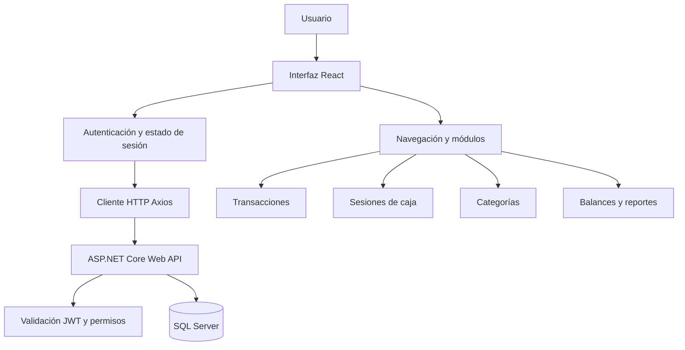
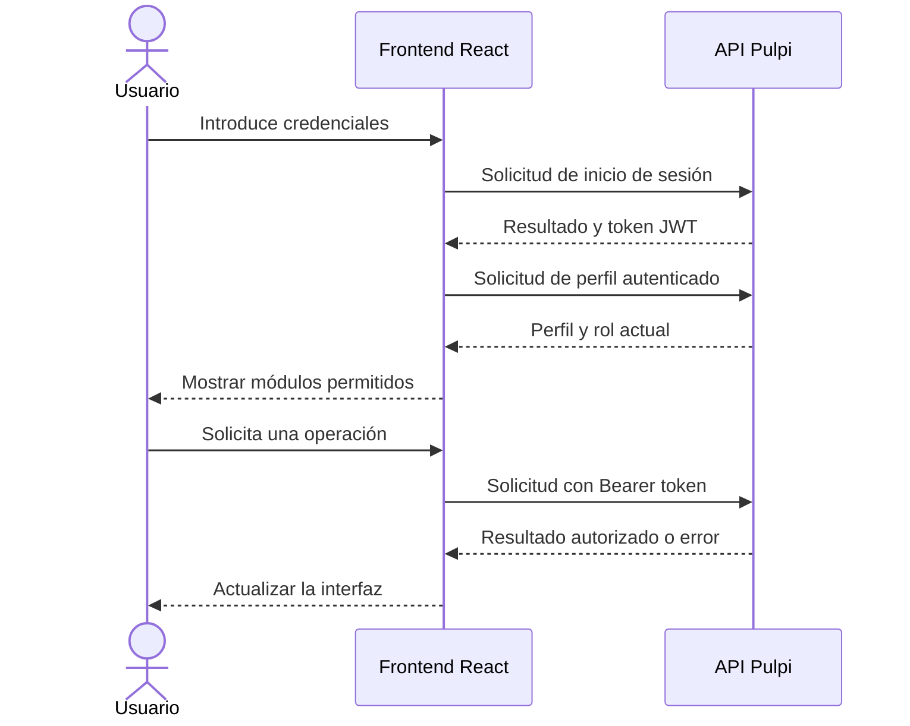
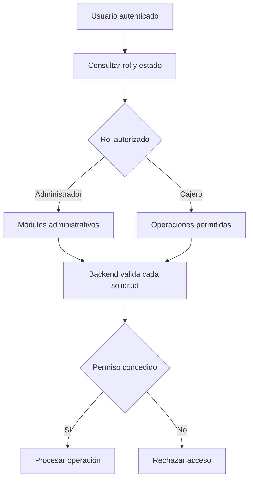
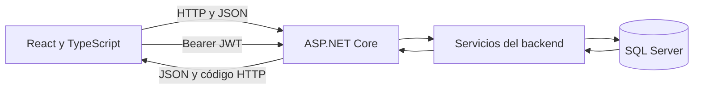

# Pulpi React — Frontend Typescript

Interfaz web del sistema Pulpi, desarrollada con React y TypeScript. Permite interactuar con los módulos de gestión financiera y consumir los servicios del backend mediante una API REST.

## Funcionalidades

### Autenticación
- Interfaz de inicio de sesión.
- Registro de usuarios.
- Gestión del estado de autenticación.
- Integración con autenticación mediante JWT.
- Consulta y validación del perfil de usuario a través del backend.

### Panel principal
- Navegación entre los módulos de la aplicación.
- Presentación de información según los permisos del usuario.
- Acceso a las operaciones administrativas y de caja autorizadas.

### Transacciones
- Registro y consulta de ingresos y gastos.
- Selección de categorías.
- Validación de montos, fechas y campos requeridos.
- Asociación de movimientos con usuarios y sesiones de caja.

### Categorías
- Consulta de categorías.
- Creación, edición y desactivación de categorías según los permisos disponibles.

### Sesiones de caja
- Apertura y cierre de caja.
- Consulta de sesiones autorizadas.
- Presentación del resultado del cierre según los datos recibidos del backend.

### Balances y reportes
- Consulta de información financiera permitida por el rol.
- Acceso a reportes administrativos cuando el usuario cuenta con autorización.

### Usuarios y roles
- Consulta de información del usuario autenticado.
- Presentación de opciones administrativas según los permisos.
- Restricción de módulos de acuerdo con el rol asignado en el backend.

## Tecnologías

| Tecnología | Uso |
|---|---|
| React 19 | Construcción de interfaces |
| TypeScript 5.8 | Tipado estático |
| Vite 6 | Servidor de desarrollo y compilación |
| CSS | Estilos de la interfaz |
| Axios | Comunicación HTTP con la API |
| React Router DOM | Navegación entre vistas, si está configurada |
| Lucide React | Iconografía |
| JWT | Autenticación con el backend |

## Objetivo

El frontend de Pulpi proporciona la interfaz de usuario para las operaciones del sistema. La autenticación, la persistencia de datos y la autorización definitiva deben gestionarse y validarse en el backend.

## Repositorios relacionados

- Frontend: https://github.com/TheOJRZ/react-frontend-pulpi
- Backend: https://github.com/angelbarreto46u/webapi-restful-backend-pulpi
'@ | Set-Content README.md -Encoding utf8

git add README.md
git diff --cached
git commit -m "docs: document Pulpi frontend features and technologies"

@'

## Arquitectura del frontend

El frontend se comunica con el backend de Pulpi mediante solicitudes HTTP. React gestiona la interfaz y sus estados, mientras que el backend aplica las reglas de negocio y accede a SQL Server.

### Flujo de autenticación

### Acceso por roles

### Comunicación entre frontend y backend

Los diagramas representan el flujo conceptual de la aplicación. Las rutas, los componentes y los mecanismos de autenticación deben corresponder con la implementación real del proyecto.